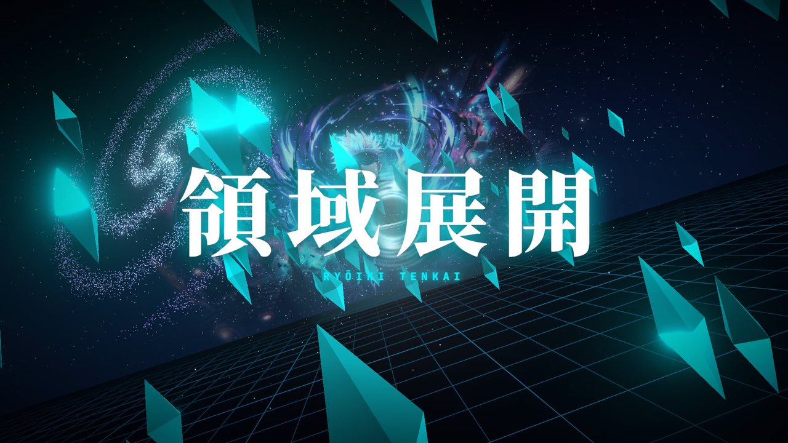
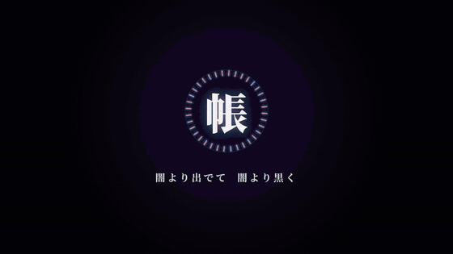
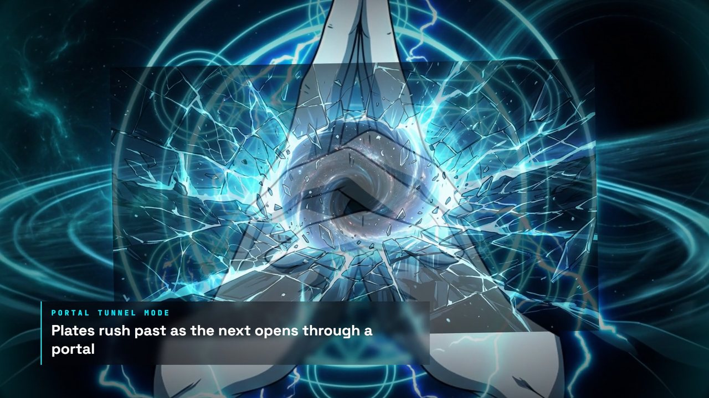
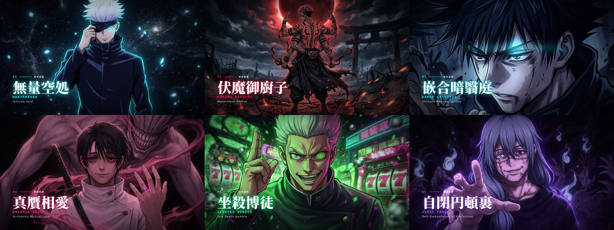
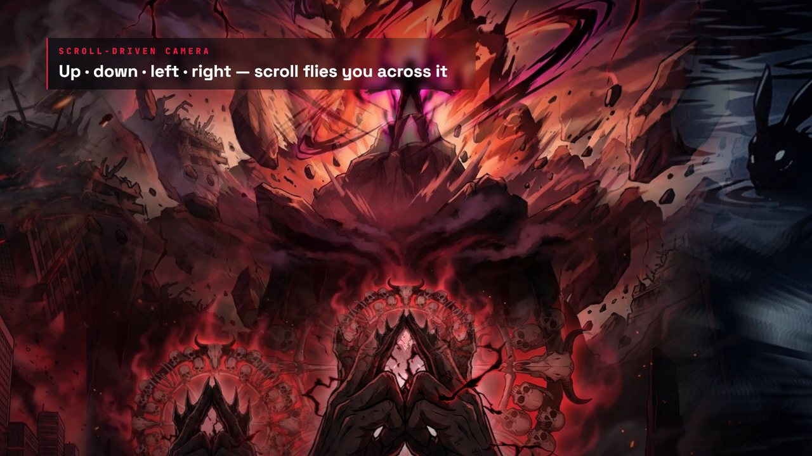
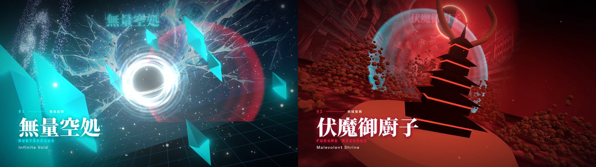

# 領域展開 // RYŌIKI TENKAI v2.0 — 2.5D Multi-Frame Depth-Tunnel & Interactive Clash Engine



An interactive frontend engineering showcase inspired by **Jujutsu Kaisen's Domain Expansions (領域展開)**. Built with **TypeScript**, **HTML5 2D/2.5D Canvas**, **Web Audio API**, and a custom **6-Keyframe Portal Depth-Tunnel Rendering Pipeline**.



---

## ✨ Key Architectural Highlights (v2.0 Upgrade)

### 1. Continuous 6-Keyframe 2.5D Portal Depth-Tunnel Engine (`src/engine/renderer.ts`)
Instead of panning a single static image, each of the **6 Domain Expansions** is powered by **6 progressive keyframe plates** (`36 total plates` across 240 scroll ticks):
- **Frame 00 (`開眼 AWAKENING`)**: Macro focus on the sorcerer's eyes / cursed aura ignition.
- **Frame 01 (`詠唱 INCANTATION`)**: Mid-shot cursed energy vortex and sacred geometry convergence.
- **Frame 02 (`印契 SACRED MUDRA`)**: Macro focus on the deity hand seal and plasma shockwaves.
- **Frame 03 (`破断 BARRIER FRACTURE`)**: Euclidean space shattering into a radial dimensional portal.
- **Frame 04 (`展開 INNATE LANDSCAPE`)**: Emerging through the portal into the vast architectural expanse of the Innate Domain.
- **Frame 05 (`必中 SURE-KILL CORE`)**: Relativistic zoom into the lethal core of the guaranteed-hit rule.



**How the Transition Works:**
- **3-Plane Depth Stack**: At any scroll position `progress ∈ [0, 1]`, the renderer composites Outgoing `Frame[k]` zooming past the camera (`1.0x → 2.35x`), Incoming `Frame[k+1]` emerging through a feathered radial portal centered at `(focalX, focalY)` (`0.42x → 1.0x`), and Lookahead `Frame[k+2]` at the deep vanishing point.
- **Peripheral 2.5D Parallax Ring**: An outer ring of `Frame[k]` scales faster (`3.1x`) than the inner plane, creating genuine peripheral motion parallax as you travel forward or backward.
- **3D Perspective Z-Tunnel (`src/engine/particles.ts`)**: Sacred geometry rings and domain-specific props (sealing talismans, floating katanas, pachinko tokens, soul sutures, crimson slashes) occupy 3D `(x, y, z)` coordinates driven by real-time `scrollVelocity`.

### 2. Complete 6-Domain Roster (`src/data/domains.ts`)
1. **Infinite Void (`無量空処`)** — Satoru Gojo (*Taishakuten Mudra*)
2. **Malevolent Shrine (`伏魔御廚子`)** — Ryomen Sukuna (*Enma-ten Mudra • 200m Open Barrier*)
3. **Chimera Shadow Garden (`嵌合暗翳庭`)** — Megumi Fushiguro (*Ten Shadows Puppet Mudra*)
4. **Authentic Mutual Love (`真贋相愛`)** — Yuta Okkotsu (*Dakiniten Mudra • Unlimited Copy Katanas & Jacob's Ladder*)
5. **Idle Death Gamble (`坐殺博徒`)** — Kinji Hakari (*Benzaiten Mudra • 4m 11s 777 Jackpot Immortality*)
6. **Self-Embodiment of Perfection (`自閉円頓裹`)** — Mahito (*Four-Handed Oral Mudra • Direct Soul Contact*)



### 3. Interactive Portfolio Features
- **⚔️ Domain Clash Tug-of-War Simulator (`src/engine/clash.ts`)**: Live split-screen canvas arena where users pit any two domains against each other, tune Barrier Refinement (`50–100%`), Cursed Energy Output (`50–200%`), Shell Conditions (*Standard Closed*, *Inverted Shell Rule*, *Shinjuku Basketball Compression*, *200m Open Barrier*), and Anti-Domain Counters (*Simple Domain*, *Hollow Wicker Basket*, *Falling Blossom Emotion*).
- **📿 120% Potential Incantation & Mudra Ritual**: Interactive 4-step chant sequence (`九綱・偏光・烏と声明・表裏の間` etc.) with a harmonic timing ring that unlocks **120% Cursed Energy Overdrive Mode** and triggers an automatic Black Flash.
- **📊 6-Axis Radar Comparison & Barrier Anatomy Codex**: Dual-polygon canvas radar chart comparing any two domains across *Refinement*, *Lethality*, *CE Efficiency*, *Activation Speed*, *Effective Range*, and *Clash Resilience*.
- **🛠️ Engineering Debug & Render Pipeline HUD**: Live 60fps profiler and sparkline graph, shader transition mode switcher (*2.5D Portal Tunnel*, *Optical Morph*, *Split Inspector*), live **Camera Frustum & Focal Reticle Wireframe** overlay, and real-time physics sliders.

### 4. World Map Camera (`src/engine/worldMap.ts`, default mode)
All 36 plates form **one giant mural on a 6×6 grid** (`src/data/world-path.json`). Scrolling flies the camera along a serpentine route through it — down, right, up, left — so each domain is a 2×3 district and the camera never just zooms forward.



- **Dwell & glide**: the camera rests on each plate (for the text), then glides to the next, pulling back mid-flight to reveal the surrounding world (further when crossing into a new domain).
- **2.5D depth**: plates sit at slightly different depths, so neighbours drift apart as the camera moves; the camera banks into lateral moves, pitches on vertical ones, and follows the mouse. A blurred backdrop layer and directional motion streaks add parallax.
- **Seamless mural**: every plate is drawn twice over the same over-sized rect — opaque, then feathered with a ramp spanning exactly the overlap zone — so neighbouring ramps are complementary and no hard edge survives. Baked-in letterbox bars in generated frames are detected and trimmed at load time.
- **Painted bridges**: 31 of the 35 seams carry a painted transition plate (`public/assets/bridges/bridge_NN.jpg`), each painted from its two neighbouring frames, then feathered and drawn over the seam at the average depth of the pair. Only steps listed in `public/assets/bridges/manifest.json` are loaded; the other four (12, 18, 23, 29, where a character sits on the seam) keep the plain cross-fade. `npm run bridges` paints any missing step with the `agy` CLI.
- **Minimap**: bottom-right overview of the whole world with route, travelled path and live viewport; click a plate to travel there.

**Three camera modes** — switch with the `地図 MAP · 界 3D · 門 TUNNEL` pill (bottom-left), the HUD, or `V` to cycle.

### 5. Domain Realms — three.js 3D World (`src/engine/world3d/`)
The third camera mode is a **built world**: each innate domain is a procedurally generated 3D realm, and scrolling flies one continuous camera path through all six — six story stations per realm — then across a misty abyss and through a **barrier membrane** into the next, while fog, sky gradient and lighting blend between realm palettes.



| Realm | What you fly through |
| --- | --- |
| 無量空処 Infinite Void | Light-grid abyss, floating crystal monoliths, a black hole with shader accretion disk, lensed halo and photon ring, 3,500 motes of information spiralling into the horizon, a spiral galaxy |
| 伏魔御廚子 Malevolent Shrine | Animated sea of blood, torii avenue, a ribcage tunnel of bone arches, a five-tier pagoda with ember-lit eaves and horns, mountains of 3,200 skulls, Dismantle slash flashes, a red eclipse |
| 嵌合暗翳庭 Chimera Shadow Garden | Black liquid mirror with spreading cyan ripples, braided shadow tendrils with fresnel rims, bobbing shadow orbs, 170 pairs of blinking shikigami eyes, a pale moon |
| 真贋相愛 Authentic Mutual Love | A field of 3,200 instanced katanas, gilded crosses, Jacob's Ladder light columns under a halo, drifting petals |
| 坐殺博徒 Idle Death Gamble | Neon grid, rails through chasing-light arches, spinning 7/BAR slot reels in a neon cabinet, a pachinko wall of 1,120 pins with falling balls, JACKPOT sign, confetti |
| 自閉円頓裹 Self-Embodiment of Perfection | Flesh membrane with pulsing veins, a forest of procedural hands, a cathedral of colossal hands closing overhead around soul-light, tentacles, rising soul wisps |

- **Sky paintings**: each realm's six keyframes hang as a vast curved painting on its horizon, cross-fading with the story phase as you advance.
- **Rendering**: custom GLSL ground (one shader, six looks, bounded and fog-faded so realms never overlap), fresnel rim material that works with `InstancedMesh`, GPU-animated particle systems, `UnrealBloomPass`, only nearby realms drawn and animated.
- **Shared effects**: the 2D canvas becomes a transparent overlay (vignette, fracture lines, 集中線 focus lines); impact frames and Black Flash are mirrored onto the WebGL canvas as CSS filters.
- **Code-split**: three.js is downloaded only the first time 3D mode is chosen.

### 6. Cinematic Polish Layer
- **帳 Veil Loader**: The curtain incantation (`闇より出でて闇より黒く…`) types in while a 36-tick seal ring lights up per decoded keyframe plate; entering lifts the veil with a circular reveal and unlocks WebAudio from the click.
- **Manga Impact Frames (`集中線`)**: Crossing into a new domain fires a few frames of inverted monochrome / domain-tinted flicker with radial focus lines, composited in Canvas2D via `saturation` + `difference` blend modes.
- **Feathered Portal Plates**: The incoming plate is rendered to an offscreen buffer and masked with a separable rectangular feather that narrows to zero as it fills the screen, so no hard plate edge is ever visible.
- **Pointer Parallax Camera**: The mouse steers the camera; near, incoming and lookahead planes shift by different amounts for real depth separation.
- **Kinetic Typography**: Titles split into per-character reveals (blur → focus, kanji "stamp" scale-in), labels scramble-decode through cursed glyphs on entry.
- **Cursor Reticle, Film Grain, `prefers-reduced-motion`**: Domain-coloured lagging reticle, animated SVG-noise grain, and a reduced-motion mode that disables shake, impact frames, parallax and chromatic aberration.

---

## 🚀 Getting Started

```bash
# Install dependencies
npm install

# Start Vite development server
npm run dev

# Type-check and build for production
npm run build
```

## ⌨️ Keyboard Shortcuts
- `1` – `6` : Switch between the 6 Domain Expansions
- `Space` : Trigger **Black Flash (`黒閃 KOKUSEN`)**
- `D` : Trigger **0.2-Second Shibuya Domain Expansion Burst** (impact frame + barrier shatter)
- `R` : Open **120% Potential Incantation Ritual**
- `C` : Jump to **Interactive Domain Clash Lab**
- `H` : Toggle **Engineering Render Pipeline HUD**
- `V` : Cycle camera mode (**2D World Map** → **3D Domain Realms** → **Portal Tunnel**)
- `M` : Toggle Procedural WebAudio Soundscape
